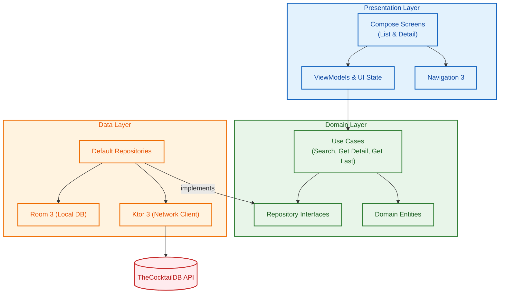

# CocktailApp

The app presents a **search screen**, allowing users to browse cocktails by name or ingredient.

It also includes a **detail page**, offering additional info and instructions for cocktail preparation.

## Tech Features
- **Compose UI** using Material 3 and Navigation 3.
- **Data persistence** using Room 3, for fast retrieval and offline access.
- **Dependency Injection** using Hilt.
- **Network Error Handling** with appropriate UI feedback.
- **Unit tests** using Kotest, MockK, Turbine and Kover.
- **Ui tests** for Compose, using Robolectric and JUnit

---

## Architecture and patterns

The app follows **Clean Architecture**, **UDF** and **MVVM**, in order to keep the codebase easy to understand, maintain and expand.

The codebase is structured as such:

