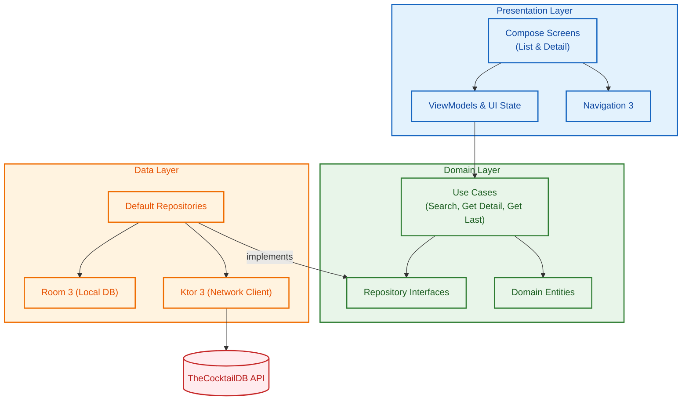

# CocktailApp
The app presents a **search screen**, allowing users to browse cocktails by name or ingredient.

It also includes a **detail page**, offering additional info and instructions for cocktail preparation.

## Tech Features
- **Compose UI** using Material 3 and Navigation 3.
- **Data persistence** using Room 3, for fast retrieval and offline access.
- **Dependency Injection** using Hilt.
- **Network Error Handling** with appropriate UI feedback.
- **Unit tests** using Kotest, MockK, Turbine and Kover.

---

## Architecture and patterns

The app follows **Clean Architecture**, **UDF** and **MVVM**, in order to keep the codebase easy to understand, maintain and expand.

The codebase is structured as such:

---

## Instruments, documentation and external projects
The following is a summary of the tools, docs and references used during development.

#### IDE
AndroidStudio Rabbit

#### AI Agents
I used Gemini 3.6, bundled with Android Studio, mostly for speeding up the writing of boilerplate, implementing simple tests, and for help with bug solving.
The mermaid graph above was also generated by Gemini (but not the rest of the readme!)

#### Forums
I often use StackOverflow, Medium and ProAndroidDev for help with bug solving. In this case though, official doc and AI covered most of my needs.

#### Other projects
I re-used some of the Gradle/CI config, KtLint/Detekt settings and Logger classes from a toy project of mine.

The project is open source, and is available on this [GitHub repo](https://github.com/Riccardo-Gennari/chess-public).

#### Official documentation
Many libraries used by the project offer a dedicated site explaining their API and integration steps. I needed to consult these during development.
Some examples are [Ktor](https://ktor.io/docs/client-dependencies.html), [Room](https://developer.android.com/jetpack/androidx/releases/room3), [Coil](https://coil-kt.github.io/coil/) and [Navigation3](https://developer.android.com/guide/navigation/navigation-3/get-started).

The [CocktailDB API](https://www.thecocktaildb.com/documentation) reference was also fundamental to understand, since the data returned from their API calls practically determined the app domain, and shaped the UI. To better visualize this information, I used Swagger (they offer compatible .yaml exports).

Last but not least, [Android Developers](https://developer.android.com) remains the fundamental reference for everything concerning Android and Compose, with Google's guidelines on best practices and architecture being extremely helpful.
